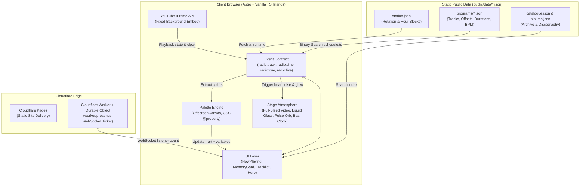

<div align="center">

# AGAIN RADIO

**24 hours of a life in progress.**
*A synchronized, always-on fan broadcast for Fred again..'s catalogue, where every track carries the memory it came from.*

[](https://again-radio.pages.dev)
[](https://astro.build)
[](https://tailwindcss.com)
[](https://www.typescriptlang.org)
[](https://workers.cloudflare.com)
[](LICENSE)

[**Live Station**](https://again-radio.pages.dev) &nbsp;•&nbsp; [**The Philosophy**](#the-philosophy-one-voice-then-a-room) &nbsp;•&nbsp; [**Architecture**](#architecture) &nbsp;•&nbsp; [**Memory Layer**](#the-memory-layer) &nbsp;•&nbsp; [**Controls**](#keyboard-controls) &nbsp;•&nbsp; [**Development**](#development-workflow) &nbsp;•&nbsp; [**Changelog**](CHANGELOG.md)

---

</div>

## The Philosophy: One Voice, Then a Room

Fred again..'s music runs in one direction. It starts small and private: a voice note on a phone, a stranger recorded on a night bus, a friend’s laughter, the span of months an album was lived in. Then it is carried into a room until thousands of strangers are singing a line that was never originally meant for them. The intimate becomes communal without ever losing its vulnerability.

**AGAIN RADIO** is engineered from that same thesis:
- **Fragments, not feeds.** Content arrives one piece at a time — a sampled voice, a date range, a line of memory.
- **Words are light.** Just as phrases are projected huge at Fred's shows, the name of the person behind each track commands the room, arriving word-by-word.
- **The room breathes.** The official concert video plays full-bleed behind the entire page as a living projection, overlaid by liquid glass surfaces and a reactive orb pulsating to the track's BPM grid.
- **Everyone hears the exact same moment.** It is an authentic live radio, not a personal playlist. Every listener across the globe shares the same playback second.

---

## Highlights

### 📻 Synchronized Global Broadcast
- **Epoch-Synced Playback**: Station rotation loops from a fixed epoch (`2026-01-01T00:00:00Z`). Playback position is computed deterministically:
  $$\text{position} = (\text{now} - \text{epoch}) \pmod{\text{totalRotationDuration}}$$
- **$O(\log N)$ Binary Search Schedule**: Instant track and offset resolution inside multi-hour shows using `schedule.ts`.
- **Zero-Latency "Back to Live"**: Explore tracklists or archive sets freely; return to the synchronized live broadcast with a single tap or keypress (`L`).

### 🏷️ The Memory Layer
Every song is anchored to the human fragment it was born from:
- **Sample Attribution**: Automatic extraction of real names from parenthetical track titles (e.g., *Kammy*, *Danielle*, *Delilah*, *Kyle*).
- **Date Range Stamps**: Formatted lifespans from album eras rendered as vintage camera date stamps (e.g., `JAN 1 — SEP 9 2022`).
- **Curated & Generative Memory Lines**: Curated original prose for celebrated moments, paired with honest, non-hallucinated fallbacks for deep catalog cuts.

### 🎨 Ambient Stage & Dynamic Palette Engine
- **Full-Bleed Concert Backdrop**: The official YouTube broadcast runs full-viewport behind the entire interface; sheets and controls form a tinted veil so the live show breathes through everywhere.
- **Liquid Glass Architecture**: Translucent glass surfaces (`src/lib/glass.ts`) featuring custom SVG refraction filters, pointer-responsive specular sheen, and soft frosted fallbacks.
- **Reflected Dial Cards**: The active card casts a soft, art-tinted reflection beneath the dial on desktop, with the reflection removed on mobile for a cleaner layout.
- **Dynamic Artwork Palette**: Colors are sampled in real time from album artwork using `OffscreenCanvas` (`src/lib/palette.ts`) and injected into registered CSS `@property` tokens (`--art-1`, `--art-2`, `--art-3`, `--art-accent`) for smooth 2.4-second crossfades.
- **Tempo Beat Clock & Reactive Orb**: Because YouTube audio cannot be directly analyzed across origins, a rAF tempo clock (`src/lib/pulse.ts`) locks onto the track's BPM grid, pulsing the kinetic hero typography and the floating Siri-style orb (`src/components/Orb.astro`) on every kick and offbeat.
- **Rory Voice & Motion Graphics Morphing**: When Rory speaks, the conic-mesh orb dynamically morphs into Siri-style multi-ribbon speech waves and back across a continuous 4-stage state machine (`idle` ↔ `morph-to-speech` ↔ `speech` ↔ `morph-to-orb`). Powered by raw WebGL (`src/components/orb-wave.ts`), it features optical screen-blended wavefront expansion and implosion (`.o-morph-ring`), celestial vocal luminescence (`.o-aura`), an ambient chromatic capsule underglow (`.o-body`), and artwork-derived palette absorption (`uC1`..`uC4`) while preserving calibrated shader intensity and respecting `prefers-reduced-motion`.
- **Pointer-Fed Orb & Show Radar**: On desktop, cursor light bends toward the orb as it approaches; the concert timeline carries a subtle moving signal from “now” toward the next show. Both cues honor reduced-motion preferences.
- **Unified Footer Actions**: Social links and the support panel use a shared footprint, keeping the bottom actions balanced across screen sizes.

### 🎙️ Rory, the Host
A pre-recorded radio jockey (`src/lib/jockey.ts`, lines in `public/data/jockey.json`, voice by ElevenLabs).
- **What Rory says**: a time-of-day welcome on tune-in, two intros per song, back-announces, mid-song thoughts, set handovers, and every few minutes a listener shout-out, sourced fact or station ID.
- **Only over audible music**: nothing is announced until YouTube is actually playing, intros only run if they end before the vocals, and the music is ducked under Rory, never muted.
- **Listener's choice**: after the first welcome a panel asks what Rory should do (hello, intros, back-announces, thoughts, shout-outs and facts), with select/clear all. The mic button in the controls reopens it any time (`src/components/rory-panel.ts`).
- **Recording new lines**: `node scripts/generate-jockey-audio.mjs` spreads synthesis across two ElevenLabs accounts and keeps a credit reserve on each; see `docs/elevenlabs-strategy.md`.

### 📡 New on the Channel
New official music on Fred again..'s YouTube channel joins the station on its own.
- **Daily check**: `.github/workflows/new-music.yml` runs `scripts/new-music.mjs`, which reads the channel's upload feed and keeps music only (no Shorts, premieres, trailers, interviews or sets; 1–10 minutes). New uploads go into `public/data/new-music.json`.
- **You approve**: the workflow checks the data, runs the tests and builds, then opens a pull request listing each song with its YouTube link. It never deploys or pushes to `main`; merge and deploy as usual.
- **On air**: the 20 newest songs play back to back as "New on the channel", newest first, rest shuffled each cycle. Older songs move into the general rotation as their own short slots ("From the channel"). Several uploads of one song are one slot, with the version picked per week. All of them are in search.
- **By hand**: `node scripts/new-music.mjs` (the first run, with no data file, takes the last 90 days).

### 🌌 The Aesthetic: Rave (The Room)

The interface is built around a single, cohesive aesthetic &mdash; **Rave** (`data-theme="sleek"`):
- **Medium**: The room at the show &mdash; stage lights on the crowd, soft lens bloom, and projected typography.
- **Ground**: Deep, dark backdrop derived from the track's shadowed artwork colors.
- **Typography**: Precision tabular numbers and clean headings set in self-hosted **Instrument Sans**, paired with poetic memory lines in **Instrument Serif**.
- **Atmosphere**: Radial stage vignette and subtle analog film grain overlay that remains fixed to prevent scrolling repaints.

---

## Complete Catalogue & Programs

AGAIN RADIO streams across extensive continuous sets and multi-year eras:
- **Boiler Room: London** (2022-07-29) &mdash; 71 minutes of genre-defining energy.
- **Rooftop Live (Arun's Roof)** &mdash; Intimate acoustic sessions and early voice notes.
- **Alexandra Palace** &mdash; Massive arena set with Bangalter, Skrillex & Four Tet eras.
- **Rooftop Naples** &mdash; Sun-drenched open-air live electronics.
- **USB002 Every Show** &mdash; Comprehensive 108-hour archival rail traversing 20+ live shows from 2019 to 2026.
- **Tour Radar** &mdash; Live countdowns to upcoming tour stops (Delhi, Mumbai, Bengaluru).

---

## Real-Time Presence

AGAIN RADIO displays the count of concurrent listeners tuned in around the world.
- Powered by a lightweight **Cloudflare Worker** paired with a **Durable Object** (`worker/presence`).
- WebSocket connections are aggregated with a debounced 1000ms broadcast cycle.
- **No data stored. No listener tracking.** The count is real or hidden &mdash; never fabricated.

---

## Keyboard Controls

Navigate the station without taking your hands off the keyboard:

| Key | Action |
|:---:|---|
| <kbd>Space</kbd> | Play / Pause playback |
| <kbd>M</kbd> | Mute / Unmute audio |
| <kbd>→</kbd> | Jump to next track in the running order |
| <kbd>←</kbd> | Jump to previous track in the running order |
| <kbd>L</kbd> | Resync back to the live global broadcast |
| <kbd>/</kbd> | Open the instant catalogue search sheet |

---

## Architecture



### Repository Structure

```
again-radio/
├── docs/
│   ├── SPEC.md             # Project contract, rights, data models
│   └── DESIGN.md           # Design language, typography, motion tokens
├── public/
│   ├── data/
│   │   ├── station.json    # Rotation schedule & hour block definitions
│   │   ├── albums.json     # Curated discography & MBID metadata
│   │   ├── catalogue.json  # Full search index & live set database
│   │   └── programs/       # Show tracklists with offsets and durations in seconds
│   └── fonts/              # Self-hosted Instrument Sans & Serif (subset)
├── src/
│   ├── components/         # Astro components + dedicated TypeScript islands
│   │   ├── Orb.astro       # Reactive conic-mesh orb + Siri speech morpher
│   │   ├── orb.ts          # Rory voice 4-state transition machine
│   │   ├── orb-wave.ts     # Raw WebGL Siri Wave dynamic distance field engine
│   │   └── orb-colour.ts   # Dynamic artwork palette extraction & complements
│   ├── lib/
│   │   ├── events.ts       # Central event bus contract
│   │   ├── schedule.ts     # Global epoch sync & binary search scheduler
│   │   ├── palette.ts      # OffscreenCanvas artwork color extraction
│   │   ├── memories.ts     # Memory line composer & title parser
│   │   ├── pulse.ts        # BPM beat clock tracking
│   │   └── yt.ts           # YouTube IFrame API controller
│   └── pages/
│       └── index.astro     # Main station page
├── styles/
│   └── theme.css           # Token definitions, themes, registered @property vars
├── worker/
│   └── presence/           # Cloudflare Worker + Durable Object for live presence
└── scripts/
    ├── verify.mjs          # Data integrity, schema, and layout verification
    ├── schedule.test.mjs   # Time sync and schedule unit test suite
    ├── orb-transition.test.mjs # Rory voice animation transition state tests
    └── shot.mjs            # Local headless screenshot runner
```

---

## Development workflow

Current project version: **0.2.0**. The version in `package.json` is canonical; keep
the root version in `package-lock.json` in sync. Release notes live in
[`CHANGELOG.md`](CHANGELOG.md).

When running the development server (`npm run dev` or `npx astro dev`), the site will **not** automatically reload on file changes. Hot Module Replacement (HMR) and live reload have been disabled in `astro.config.mjs`. To see your changes, manually refresh the browser page.

This ensures a stable dev environment where the page only updates on explicit user action.

### Prerequisites
- **Node.js**: v20 or higher
- **npm**: v10 or higher

### 1. Clone & Install
```bash
git clone https://github.com/amansn7/again-radio.git
cd again-radio
npm install
```

### 2. Start Development Server
```bash
npm run dev
```
Open [http://localhost:4321](http://localhost:4321) to tune into the local live stream.

### 3. Run Verification Tests
```bash
# Verify all program data, track integrity, offsets, and schemas
node scripts/verify.mjs

# Run logic & algorithmic self-tests
node scripts/verify.mjs --selftest

# Test live schedule calculations across time zones
node scripts/schedule.test.mjs
```

### 4. Build for Production
```bash
npm run build
```
Generates a static build inside `dist/`.

### Versioning and release notes

AGAIN RADIO uses Semantic Versioning (`MAJOR.MINOR.PATCH`):

- **Patch** for backward-compatible fixes and small corrections.
- **Minor** for backward-compatible features and meaningful data additions.
- **Major** for changes that break established behavior or data contracts.

For each release, update the version in `package.json` and the root package entries in
`package-lock.json`, add a dated section to `CHANGELOG.md`, then run the verification
commands above. Use a `vMAJOR.MINOR.PATCH` Git tag for published releases. Ordinary
commits do not need a version bump; keep release notes under `Unreleased` until a release
is prepared.

---

## Rights & Ethics (Strict Guarantees)

This project strictly adheres to digital ethics and music copyright standards:
1. **Official Embeds Only**: All audio streams directly through official YouTube video embeds. Audio is **never** downloaded, proxied, or re-hosted.
2. **Hotlinked Artwork**: Album art is dynamically resolved and hotlinked via [Cover Art Archive](https://coverartarchive.org/) and iTunes APIs with keyless CORS. No image assets are stored locally or redistributed.
3. **Original Memory Prose**: Memory layer text is written originally from researched public facts; no copied interview transcripts or press quotes.
4. **Zero-Tracking Presence**: The live listener counter operates entirely in ephemeral memory via Cloudflare Durable Objects. No IP addresses, user identifiers, or cookies are stored.

---

## Disclaimer

> **Fan project. Not affiliated with Fred again.. or Atlantic Records / Warner Music Group.**
> All music, recordings, and artwork belong to their respective copyright owners.

<div align="center">
<sub>Built with care for the music, the rooms, and the memories.</sub>
</div>
