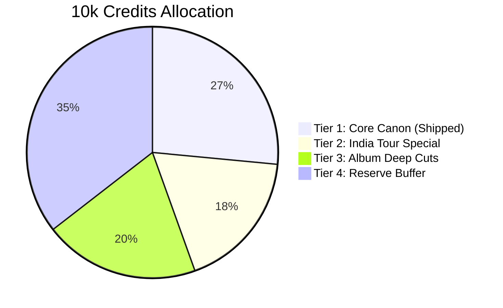

# ElevenLabs 10k Credits: Efficiency & Iteration Strategy

Strategy for getting maximum broadcast value out of ElevenLabs' free monthly 10,000 credit allocation for **AGAIN RADIO**'s AI radio jockey, Rory.

**Current balance snapshot (20 Nov 2026):** user reported 2,404 credits used; the API preflight
then showed 7,596 remaining. The eight Rory pilot intros used 347 characters, so the estimated
balance is 2,751 used / 7,249 remaining. The synthesis script requires a successful quota
preflight before it sends generation requests.

---

## The Math: What 10,000 Credits Actually Gives Us

| Model | Character Cost | 10k Credits Yield | Spoken Audio Yield |
|---|---|---|---|
| `eleven_flash_v2_5` | **0.5 credits** / char | **20,000 characters** | ~40–50 minutes (~70–80 radio clips) |
| `eleven_turbo_v2_5` | **1.0 credit** / char | **10,000 characters** | ~20–25 minutes (~35–40 radio clips) |
| `eleven_multilingual_v2`| **1.0 credit** / char | **10,000 characters** | ~20–25 minutes (~35–40 radio clips) |

> [!TIP]
> **Free Tier Refreshes Monthly**: ElevenLabs resets the 10,000 character limit every month. Audio saved into `public/audio/jockey/*.mp3` is permanently cached and never costs credits again. Over 3–4 months, the station naturally builds a library of **150+ studio-grade clips** without spending a penny.

---

## Strategy Pillars

### 1. Pre-Render & Git-Commit (Zero Redundant Spend)
- **Never synthesize on user request in production**: Calling the ElevenLabs API live in the client on every page load would exhaust 10,000 credits in less than an hour of real listeners.
- **The Pipeline**: Synthesize once with `scripts/generate-jockey-audio.mjs`, save to `public/audio/jockey/*.mp3`, and commit to Git.
- **Cache Check Guard**: The script checks `fs.existsSync(targetFile)` before calling the API. Re-running the script will never re-charge credits for clips that already exist.

### 2. Zero-Credit Drafting ("Auditioning")
Never spend credits testing raw scripts or pronunciations.
1. **Cadence & Post-Timing Check**: Test the line duration using local speech synthesis or mental BPM counting (~15 characters per second). Verify:
   $$\text{Length in characters} / 15 < \text{postSeconds} - 1.5\text{s}$$
2. **Pronunciation Verification**:
   - Write names phonetically if needed (e.g. `Obongjayar` $\rightarrow$ `Oh-bong-jay-ar`).
3. **Commit to ElevenLabs**: Only after the line is verified for length, cadence, and emotion is it added to `jockey.json` and synthesized.

### 3. Allocation Budget Across Phases (10k Budget Plan)



#### Tier 1 — Core Station Canon (Shipped: 2,651 credits)
- 28 clips: Welcome, Boiler Room transition, Naples, Times Square, Tiny Desk, Delilah, Danielle, Nathan, Kammy, Tanya, Rumble, Baby again.., Brian Eno mentorship story, Boiler Room yellow-shirt CDJ incident.
- Remaining balance: **~7,349 credits**.

#### Tier 2 — India Tour Special (Budget: ~1,800 credits)
Targeted ahead of the December 2026 tour:
- **Delhi (5 Dec)**: Countdown & venue hype clip (~200 chars).
- **Mumbai (9 Dec)**: Seaside venue & energy clip (~200 chars).
- **Bengaluru (13 Dec)**: Tour finale celebration clip (~200 chars).
- 6 track intros for India-specific favorites (*ten days* tracks, *places to be*, *adore u* extended).

#### Tier 3 — Deep Catalogue Cuts (Budget: ~2,000 credits)
- *Actual Life 1 & 2* emotional milestones (*Carlos*, *Sabrina*, *Billie*, *Baxter*, *Dermot*).
- *USB002* club weapons (*leavemealone*, *ten*, *stayinit*).

#### Tier 4 — Rolling Reserve Buffer (~3,500 credits)
- Reserved for unexpected new singles, unreleased premieres, or live stream drops.
- Rolls over with the monthly refresh.

### 4. Flair & Character Voice Tuning for Future Generations

To ensure Rory sounds like an authentic pirate radio / late-night broadcaster rather than a corporate AI assistant:

```json
{
  "model_id": "eleven_turbo_v2_5",
  "voice_settings": {
    "stability": 0.46,
    "similarity_boost": 0.78,
    "style": 0.38,
    "use_speaker_boost": true
  }
}
```

- **Lower Stability (`0.46`)**: Introduces natural breath pauses, emotional lift, and dynamic pitch inflection.
- **Style Boost (`0.38`)**: Amplifies British radio swagger, warmth, and intimate late-night energy.
- **Rhetorical Cadence**: Use ellipses (`...`) for pregnant drops, em-dashes (`—`) for conversational pivots, and British club slang (*"Hold tight..."*, *"Pure euphoria"*, *"Listen to this beat drop right here"*, *"Lock in wherever you are"*).
- **Ambient Radio Experience**: The RJ operates entirely without visible UI clutter—pure audio ducking (music automatically dips to 22% over 250ms with cubic easing and swells back to 100% over 400ms when she stops speaking).

---

## The Hybrid Architecture: Infinite Radio Without Credit Limits

To make the station feel dynamic and infinite:
1. **Tier 1 (Mastered ElevenLabs Clips)**: Pre-rendered audio clips for iconic tracks, transitions, listener milestones, and deep Fred lore.
2. **Tier 2 (Web Speech API with British Female Voice)**: Dynamic fallback if audio fails to fetch, keeping speech functional across all devices.
3. **Ambient Ducking**: Automatic cubic S-curve volume ducking lowers background stream volume to 22% during voiceovers and swells back to 100% upon conclusion.
